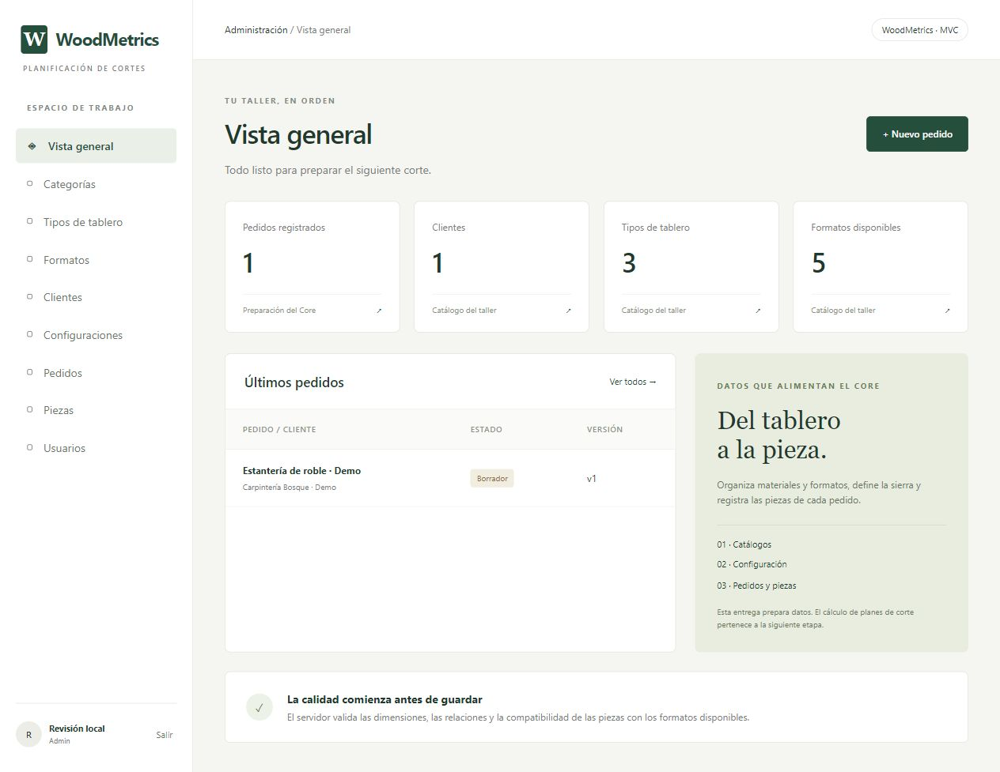
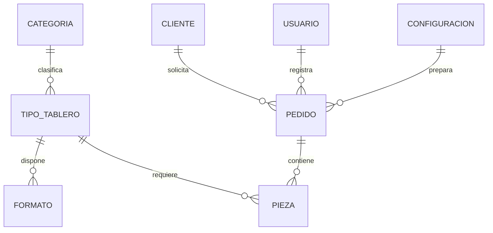

# WoodMetrics · Administración MVC

Aplicación académica de Martin Gaona para **Tarea 8: Administración MVC**, Ingeniería Web (ISWZ3101). Prepara los datos que alimentarán el Core de planificación de cortes de tableros aprobado en la especificación funcional.

**Estado:** administración implementada; el motor de optimización de cortes y sus simulaciones no forman parte de esta entrega. El despliegue requiere configurar una cuenta de alojamiento y crear el administrador.

## Qué puedes hacer

- Iniciar sesión con roles de administrador y operador.
- Crear, consultar, editar y eliminar categorías, tipos de tablero, formatos, configuraciones, clientes, pedidos, piezas y usuarios.
- Deshabilitar formatos y usuarios sin borrar sus datos.
- Seleccionar relaciones desde catálogos. En formatos y piezas, seleccionar una categoría filtra los tipos de tablero disponibles.
- Registrar piezas con medidas en milímetros, cantidad y permiso de giro.
- Cambiar pedidos entre Borrador, Listo y Cancelado; un pedido sin piezas no puede quedar Listo.
- Invalidar la preparación del pedido al cambiar sus piezas o datos: vuelve a Borrador y aumenta su versión.
- Buscar registros en cada tabla y trabajar desde pantallas adaptadas a móvil.

Los clientes son registros del negocio: no tienen acceso al sistema. Todos los datos de ejemplo son ficticios.



## Cumplimiento de la tarea

| Requisito | Implementación | Evidencia para el video |
| --- | --- | --- |
| Dato sensible validado en backend | Ancho de sierra: número finito, mayor que 0 y máximo 20 mm. También medidas, espesor, cantidad y compatibilidad de las piezas. | `woodmetrics/services.py`, prueba `test_server_rejects_invalid_sensitive_numbers`. |
| Relaciones sin escribir claves foráneas | Selectores cliente/configuración/pedido/categoría/tipo; categoría → tipos dependientes. | Crear formato, cambiar categoría y mostrar las opciones. El servidor rechaza relaciones manipuladas. |
| Versionado Git | Código, README, pruebas y workflow de GitHub Actions. | Historial del repositorio y pestaña Actions. |
| Aplicación desplegada | `render.yaml`, Dockerfile y guía incluidos. **La configuración por sí sola no constituye un despliegue**. | Mostrar la URL HTTPS real una vez publicada. |
| Video explicativo | Guion y lista de evidencias incluidos. | `docs/GUION_VIDEO.md`. La grabación y su publicación siguen pendientes. |

El ancho de sierra es un **dato crítico del negocio** porque altera la pérdida de material del futuro cálculo. Las contraseñas son, además, datos confidenciales: se validan en servidor (10–128 caracteres) y solo se guarda su hash, nunca texto plano.

## Arquitectura MVC

```text
woodmetrics/
  __init__.py        # Fábrica Flask y configuración
  models.py          # SQLite, esquema, claves foráneas y transacciones
  controllers.py     # Rutas, autenticación, permisos y coordinación
  services.py        # Reglas de validación del dominio
  seed.py            # Comandos de datos ficticios y creación de administrador
  templates/         # Vistas Jinja2
  static/            # CSS responsive y JavaScript de interfaz
tests/               # Pruebas HTTP con SQLite temporal
docs/                # Guion, despliegue y revisión local
wsgi.py              # Entrada de producción
```

Flujo: navegador → controlador → servicio de validación → modelo/SQLite → vista. JavaScript mejora la interfaz; **no decide si un dato puede guardarse**. SQLite activa `PRAGMA foreign_keys=ON` en cada conexión. Los valores SQL se envían mediante parámetros y los nombres de tabla proceden de una lista interna cerrada.

Relaciones implementadas:



Se asigna el usuario creador del pedido desde la sesión, no desde un campo editable. La fecha de creación la genera SQLite. Simulaciones, alternativas, tableros planificados, posiciones, cortes y sobrantes del diagrama global se incorporarán con el motor del Core.

## Instalación local (Python 3.12)

En PowerShell, desde la carpeta del proyecto:

```powershell
py -3.12 -m venv .venv
.\.venv\Scripts\python.exe -m pip install -r requirements.txt
$env:SECRET_KEY = (.\.venv\Scripts\python.exe -c "import secrets; print(secrets.token_hex(32))")
.\.venv\Scripts\python.exe -m flask --app wsgi seed-demo
.\.venv\Scripts\python.exe -m flask --app wsgi create-admin
.\.venv\Scripts\python.exe -m flask --app wsgi run
```

El comando `create-admin` solicita correo y contraseña, con entrada oculta. Abre http://127.0.0.1:5000 e inicia sesión con los datos que elegiste. Si usas macOS/Linux, sustituye `.venv\Scripts\python.exe` por `.venv/bin/python`.

La base se crea automáticamente en `instance/woodmetrics.sqlite`. `seed-demo` se ejecuta una sola vez y no sobreescribe un catálogo existente. No crea usuarios ni contraseñas predeterminadas. El archivo `.env.example` documenta las variables, pero la app **no carga archivos `.env` automáticamente**: configúralas en el entorno o en el alojamiento.

Para una revisión desechable, `python docs/preview_local.py` crea una base temporal y un usuario exclusivo de QA. Sus credenciales están en ese script. No emplees ese servidor ni ese usuario para publicar; al detenerlo, se elimina la base temporal.

## Validaciones del servidor

| Dato | Regla |
| --- | --- |
| Largo/ancho y mínimos reutilizables | Números finitos, mayores que 0 y máximo 10 000 mm. |
| Ancho de sierra | Mayor que 0 y máximo 20 mm. |
| Espesor | Mayor que 0 y máximo 100 mm. |
| Cantidad | Entero entre 1 y 1000. |
| Pieza | Debe caber geométricamente en un formato **habilitado** del mismo tipo, con giro solo si está autorizado. |
| Relaciones | Claves existentes y tipo perteneciente a la categoría enviada. |
| Contraseña | Entre 10 y 128 caracteres; hash de Werkzeug. |
| Catálogo referenciado | No se elimina mientras existan registros dependientes. |
| Último administrador activo | No se puede deshabilitar, degradar ni eliminar. |

Los límites son decisiones de esta implementación académica y pueden ajustarse al negocio. La comprobación de una pieza individual es preliminar: no garantiza que el pedido completo pueda cortarse ni sustituye el cálculo de sierra y distribución del futuro Core.

## Pruebas

```powershell
.\.venv\Scripts\python.exe -m unittest discover -s tests -v
```

Se prueban renderizado de módulos, CRUD, permisos, CSRF, dimensiones inválidas incluso con peticiones directas, relaciones inexistentes o incoherentes, selectores dependientes, giro, estado y versión del pedido, formatos deshabilitados, borrados referenciados y contraseñas con hash. Cada prueba usa una base temporal independiente. GitHub Actions ejecuta el mismo comando en cada push y pull request.

## Despliegue y video

Consulta [DESPLIEGUE.md](docs/DESPLIEGUE.md) y [GUION_VIDEO.md](docs/GUION_VIDEO.md). No subas bases de datos, claves, `.env` o credenciales al repositorio. `.gitignore` excluye esos archivos.

Para producción configura una `SECRET_KEY` estable y aleatoria, HTTPS y `COOKIE_SECURE=1`. Usa un proceso WSGI; no el servidor de desarrollo de Flask. El Dockerfile escucha en 8000 y requiere montar un volumen en `/data`. Render usa su variable `$PORT` y disco en `/var/data`.

## Alcance y límites

La entrega es la administración que alimenta el Core, no un optimizador completo. No incluye inventario real, pagos, control de máquinas, piezas curvas, simulaciones ni vistas SVG de resultados. Incluye protección CSRF, consultas parametrizadas, sesiones firmadas y permisos de rol. No incluye recuperación de contraseña, auditoría completa ni limitación de intentos de login; son mejoras necesarias antes de un uso real de producción.
